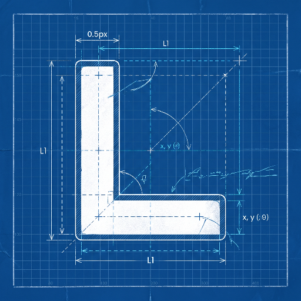
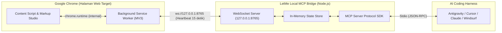

<p align="center">
  
</p>

<h1 align="center">LetMe</h1>

<p align="center">
  <b>Inspektor visual UI/UX presisi tinggi, pelacak bug layout, dan jembatan debugging multi-elemen untuk AI Coding Agent via Model Context Protocol (MCP).</b>
</p>

<p align="center">
  <a href="#lisensi"></a>
  <a href="CHANGELOG.md"></a>
  <a href="https://www.typescriptlang.org/"></a>
  <a href="https://developer.chrome.com/docs/extensions/mv3/"></a>
  <a href="https://modelcontextprotocol.io/"></a>
  <a href="https://nodejs.org/"></a>
</p>

<p align="center">
  <a href="README.md">English</a> &bull; <a href="README.id.md"><b>Bahasa Indonesia</b></a> &bull; <a href="CHANGELOG.md">Changelog (v3.0.0)</a>
</p>

---

## Gambaran Umum

Prompt berbasis teks saja sangat tidak efektif untuk menyampaikan bug visual, hierarki antarmuka, dan tata letak frontend kepada AI coding assistant. Menjelaskan pergeseran layout CSS, pemotongan elemen (*clipping*), tabrakan *z-index*, dan *responsive wrapping* yang bermasalah di dalam chat sering kali berujung pada tebak-tebakan kode yang memakan waktu.

**LetMe** mengatasi kesenjangan ini. LetMe menghubungkan layar browser aktif Anda secara langsung ke AI Coding Agent (**Google Antigravity**, **Cursor**, **Claude Desktop**, **Windsurf**, dan **Cline**) menggunakan protokol standar terbuka [Model Context Protocol (MCP)](https://modelcontextprotocol.io/).

Dengan LetMe, Anda dapat menginspeksi elemen DOM, menggambar anotasi visual pada kanvas, menjalankan audit otomatis berbasis Vision AI, men-stage banyak komponen sekaligus, serta mengizinkan asisten AI menyuntikkan **live CSS preview dua arah** langsung ke dalam tab browser Anda sebelum melakukan perubahan kode.

---

## Fitur Utama

### 1. Precision Element Inspector & Floating Studio HUD
- **Floating HUD (Excalidraw × Photoshop)**: Toolbar melayang di tengah atas, **Layers Panel** dengan thumbnail preview tiap elemen yang di-pick, dan **Properties Modal** di sebelah kanan yang terisolasi penuh dengan Shadow DOM.
- **Blueprint Selection & Multi-Layer Tagging**: Pick banyak elemen sekaligus dengan *corner handles* ala CAD/Figma, callout dimensi, tag kategori (`Bug`, `Design`, `Edit`, `Note`), catatan per-layer, dan **Raw Payload Preview**.
- **Diagnostik Box Model & Layout Otomatis**: Mengukur sub-piksel box model, selector CSS deterministik, cuplikan outerHTML, serta mendeteksi *ancestor clipping*, tabrakan *z-index*, dan kebocoran horizontal scroll.

### 2. Canvas Markup Studio (Transform & Anotasi Lengkap)
- **Alat Vektor Lengkap**: Gambar 6 bentuk (*Box, Rounded Box, Circle, Diamond, Triangle, Pill*), panah, garis alignment, penggaris piksel, pena bebas, **inline text langsung di kanvas** (*Montserrat, Poppins, Calibri, Arial, 4-Bit*), dan **pixelated Censored blur** dengan ikon.
- **8-Handle Resize, Rotate & Eraser**: Gunakan **Hand (`H`)** untuk menggeser, resize 8 sisi, atau memutar (*rotate*) objek apa pun; gunakan **Eraser (`E`)** untuk hapus per-objek dengan sekali klik; pilih warna bebas lewat **Color Picker lingkaran + input Hex** dan atur ketebalan **`▲/▼` px**.
- **Anotasi Terikat per-Layer**: Coretan tersimpan terpisah di masing-masing layer agar tidak bercampur saat berpindah elemen.

### 3. Monochrome Blueprint Popup, Dynamic Island & Custom Shortcuts
- **Tema Monochrome Black & White Blueprint**: Antarmuka popup bergrid teknis hitam-putih dengan grup **Pick & audit** (`Pick Audit` + `Pick with AI`) dan **Dynamic Island** untuk memilih mode `Screenshot` (`Area Crop` / `Full Viewport`).
- **Custom Multi-Key Shortcuts**: Atur shortcut untuk ke-4 tombol utama langsung di `Settings → Shortcuts` (mendukung kombinasi modifier seperti `Alt+Shift+I` maupun *multi-press chord* seperti `I+O+U`).

### 4. Right MCP Storage Sidebar & Bidirectional Live CSS Preview
- **MCP Storage Inspector**: Panel kanan full-height (`MCP (N)`) yang bisa di-Show/Hide untuk melihat daftar snapshot yang sudah terbaca di MCP Server dan menghapus item yang salah kirim.
- **Live CSS Preview Tanpa Reload**: Coding agent dapat memanggil `letme_apply_css_preview` dan `letme_clear_preview` untuk menguji perbaikan CSS langsung di browser aktif.

### 5. AI Vision Auto Bug Hunter & Area Screenshot Studio
- **Audit Otomatis Multimodal**: Memanfaatkan Vision LLM (Gemini, OpenRouter, OpenAI, Groq, Ollama) dengan pin 60 FPS dan filter tingkat keparahan.
- **Area Crop & Full Viewport**: Seleksi crosshair atau tangkapan layar penuh dengan sinkronisasi clipboard instan.

---

## Arsitektur Sistem



### Alur Komunikasi:
1. **Ekstensi Chrome (Client)**: Content script menangkap snapshot DOM, box model, dan tangkapan layar visual, lalu meneruskannya ke background service worker.
2. **WebSocket Bridge**: Service worker menyalurkan payload ke `ws://127.0.0.1:8765` dengan mekanisme auto-reconnect dan sinyal heartbeat keepalive setiap 15 detik.
3. **MCP Server**: Mengimplementasikan Model Context Protocol melalui standard input/output (`stdio`), menyajikan tool terstruktur, laporan markdown, dan blok gambar visual ke AI harness.
4. **Umpan Balik Live**: Mutasi styling yang dipanggil oleh AI dikirimkan kembali melalui WebSocket untuk menyuntikkan stylesheet preview ke DOM browser secara real-time.

---

## Panduan Cepat

### Pilihan Instalasi & Eksekusi

Anda dapat menjalankan LetMe MCP Bridge secara instan menggunakan `npx` atau mengkloning repositori untuk membangun ekstensi Chrome dan server secara lokal dari source code.

#### Pilihan A: Peluncuran Cepat via NPX (Tanpa Kloning)
Konfigurasikan klien AI Anda (Cursor, Claude, Antigravity) untuk langsung menjalankan server via `npx`:

```json
{
  "mcpServers": {
    "letme": {
      "command": "npx",
      "args": ["-y", "@letme/mcp-server"]
    }
  }
}
```

Atau pasang secara global di komputer Anda:
```bash
npm install -g @letme/mcp-server
letme-mcp
```

#### Pilihan B: Kloning & Bangun dari Source (Ekstensi Penuh + Server)
```bash
git clone https://github.com/jinkaka98/LetMe.git
cd LetMe
npm install
npm run build
```

Perintah di atas akan mengompilasi seluruh paket (`@letme/shared`, `@letme/mcp-server`, dan `@letme/extension`).

### Memasang Ekstensi di Google Chrome

#### Metode 1: Unduh Rilis Siap Pakai (Tercepat)
1. Unduh file **`letme-extension-v3.0.0.zip`** dari halaman [GitHub Releases](https://github.com/jinkaka98/LetMe/releases).
2. Ekstrak file zip tersebut ke salah satu folder di komputer Anda.
3. Buka Google Chrome dan buka `chrome://extensions/`.
4. Aktifkan sakelar **Developer mode** di pojok kanan atas.
5. Klik **Load unpacked** lalu pilih folder hasil ekstrak tadi.
6. Sematkan (*pin*) ikon ekstensi **LetMe** di toolbar browser Anda.

#### Metode 2: Pasang dari Kompilasi Lokal (Source Code)
Jika Anda mengkloning dan mengompilasi dari sumber:
1. Buka Google Chrome dan buka `chrome://extensions/`.
2. Aktifkan **Developer mode**.
3. Klik **Load unpacked** dan pilih direktori:
   ```
   <PATH_TO_LETME>/packages/extension/dist
   ```
*(Anda juga dapat membuat file zip portabel kapan saja dengan menjalankan `npm run package:extension`)*.

---

## Konfigurasi AI Agent

Daftarkan LetMe ke aplikasi coding AI pilihan Anda dengan menyalin konfigurasi server berikut ke file pengaturan MCP terkait.

### Google Antigravity IDE
Tambahkan ke `~/.gemini/config/mcp_config.json`:
```json
{
  "mcpServers": {
    "letme": {
      "command": "node",
      "args": ["/JALUR/ABSOLUT/KE/LetMe/packages/mcp-server/dist/index.js"]
    }
  }
}
```

### Cursor
Tambahkan ke `.cursor/mcp.json` (atau melalui **Cursor Settings > Features > MCP Servers**):
```json
{
  "mcpServers": {
    "letme": {
      "command": "node",
      "args": ["/JALUR/ABSOLUT/KE/LetMe/packages/mcp-server/dist/index.js"]
    }
  }
}
```

### Claude Desktop
Tambahkan ke `claude_desktop_config.json` (macOS: `~/Library/Application Support/Claude/claude_desktop_config.json`, Linux: `~/.config/Claude/claude_desktop_config.json`, Windows: `%APPDATA%\Claude\claude_desktop_config.json`):
```json
{
  "mcpServers": {
    "letme": {
      "command": "node",
      "args": ["/JALUR/ABSOLUT/KE/LetMe/packages/mcp-server/dist/index.js"]
    }
  }
}
```

### Windsurf & Cline
Tambahkan ke konfigurasi MCP pada ekstensi terkait:
```json
{
  "mcpServers": {
    "letme": {
      "command": "node",
      "args": ["/JALUR/ABSOLUT/KE/LetMe/packages/mcp-server/dist/index.js"]
    }
  }
}
```

---

## Alur Kerja Penggunaan

### Alur A: Inspeksi Elemen Tunggal & Anotasi Kanvas
1. Tekan pintasan keyboard `Alt + Shift + I` atau klik **Start Inspecting** pada popup LetMe.
2. Arahkan kursor dan klik elemen target pada halaman web.
3. Gunakan toolbar untuk menggambar panah, memberi kotak sorot, menambahkan catatan teks, atau mengukur jarak dengan alat penggaris.
4. Klik **Send to AI** (atau **Copy Prompt**).
5. Buka chat AI Anda dan tekan `Ctrl + V`. Prompt langsung berisi selector DOM, dimensi box model, dan instruksi Anda.
6. AI akan otomatis memanggil tool `letme_get_active_element` untuk membaca crop visual dan gaya CSS terkait.

### Alur B: Pemindai Bug Mandiri (AI Vision Auto Bug Hunter)
1. Buka popup LetMe -> Klik tab **Settings** untuk memilih penyedia AI dan memasukkan API Key (Google Gemini, OpenRouter, OpenAI, Groq, atau Ollama lokal).
2. Klik **Scan Page with AI Vision**.
3. LetMe menangkap viewport, menormalkan koordinat piksel sesuai DPR 1:1, dan mengirimkannya ke model visual.
4. Penanda pin bernomor (`#1`, `#2`, dll.) langsung menempel pada elemen yang mengalami cacat tampilan di layar.
5. Tinjau rincian bug pada floating drawer di pojok kanan bawah, atau klik **Send All to MCP**.
6. Prompt instruksi lengkap otomatis tersalin ke clipboard dengan kode unik (`[LETME MCP REPORT: LTM-AI-...]`).
7. Paste ke chat AI Anda agar seluruh bug diperbaiki sekaligus.

### Alur C: Multi-Element Stager
1. Buka popup LetMe -> Klik **Pick Elements & Staging**.
2. Klik beberapa komponen di halaman (misalnya tombol navigasi, kartu konten, modal).
3. Buka **Staging Pill** melayang di pojok kanan bawah untuk memeriksa daftar komponen.
4. Tulis catatan atau instruksi khusus untuk masing-masing elemen pada drawer.
5. Klik **Sync to MCP** dan paste prompt yang tersalin ke chat AI.

### Alur D: Live CSS Preview Dua Arah
1. Saat asisten AI Anda mengusulkan perbaikan tampilan, minta AI mengujinya secara langsung:
   > *"Tolong aplikasikan CSS preview untuk mengecek perbaikan layout pada `.hero-card`."*
2. AI menjalankan tool `letme_apply_css_preview(selector=".hero-card", cssRules={"padding": "24px", "display": "flex"})`.
3. Perubahan tampilan langsung tampak di browser Anda seketika tanpa perlu reload tab.
4. Periksa hasilnya. Jika sudah sesuai, minta AI untuk menuliskan kode final tersebut ke file proyek Anda.

---

## Referensi Tool MCP

LetMe mendaftarkan kumpulan tool berikut ke dalam protokol MCP:

| Nama Tool | Parameter | Deskripsi | Format Konten Balikan |
| :--- | :--- | :--- | :--- |
| `letme_get_active_element` | `id` *(string, opsional)*: ID elemen atau laporan spesifik | Mengambil data elemen aktif atau laporan tertentu: box model, diagnostik layout, computed CSS, dan blok gambar PNG beranotasi. | Ringkasan Markdown + Image Block PNG Base64 |
| `letme_list_inspections` | *(Tidak ada)* | Menampilkan riwayat seluruh komponen yang telah ditandai/distage dalam sesi aktif. | Tabel Markdown berisi daftar komponen, selector, dan waktu capture |
| `letme_apply_css_preview` | `selector` *(string, wajib)*: Selector CSS target<br>`cssRules` *(object, wajib)*: Pasangan key-value aturan CSS | Menyuntikkan aturan gaya CSS langsung ke elemen target di tab browser yang aktif secara real-time. | Pesan konfirmasi beserta ringkasan aturan yang disuntikkan |
| `letme_clear_preview` | `selector` *(string, opsional)*: Selector target yang ingin dibersihkan (membersihkan semua jika dikosongkan) | Menghapus stylesheet preview yang disuntikkan dan mengembalikan tampilan DOM browser ke kondisi aslinya. | Pesan konfirmasi pembatalan gaya |
| `letme_get_console_logs` | `limit` *(number, opsional, default: 20)*: Jumlah entri maksimum | Mengambil log error dan peringatan konsol browser terbaru dari halaman web aktif. | Daftar pesan konsol terformat dengan level log |
| `letme_resolve_inspection` | `id` *(string, opsional)*: ID snapshot<br>`resolutionNote` *(string, opsional)*: Ringkasan perbaikan | Menandai snapshot inspeksi sebagai `resolved` setelah AI selesai memperbaiki kode/CSS. | Pesan konfirmasi status terbaru |

---

## One-Shot AI Prompt & MCP Skill

Berikan pemahaman instan kepada AI Coding Agent Anda (**Antigravity**, **Cursor**, **Claude Code**, **Windsurf**, **Cline**) tentang cara memakai MCP Server LetMe lewat **One-Shot Prompt** atau file **MCP Skill** berikut.

### Opsi 1: One-Shot Prompt (Langsung Copy-Paste ke Chat AI)

```text
Kamu terhubung ke LetMe MCP Server (`letme`) yang menghubungkan browser Chrome aktif saya ke codebase ini.
Setiap kali saya bilang "cek LetMe", "perbaiki UI yang barusan saya kirim", atau menempelkan laporan LetMe:
1. Panggil `letme_get_active_element` (atau `letme_list_inspections` jika ada beberapa item) untuk mengambil CSS selector, Component & Source Mapping (nama komponen React/Vue, ownerChain, filePath), Semantic Anchors (nearestHeading, aria-label, data-testid), Box Model, Layout Diagnostics, anotasi/Sticky Note, dan gambar screenshot.
2. Panggil `letme_get_console_logs` bila ada kemungkinan error runtime/JS.
3. Opsional: Gunakan `letme_apply_css_preview` untuk menguji perbaikan CSS secara live di tab browser saya sebelum mengubah file kode, dan `letme_clear_preview` untuk mengembalikannya.
4. Terapkan perbaikan pada file sumber terkait, lalu panggil `letme_resolve_inspection` dengan `resolutionNote` singkat berisi file yang diubah.
```

### Opsi 2: MCP Skill Siap Pakai (`SKILL.md` / `.cursorrules`)

```markdown
---
name: letme-ui-debugger
description: Inspeksi bug UI browser, source mapping komponen, screenshot, dan sticky note via LetMe MCP, uji CSS live, lalu tandai selesai setelah kode diperbaiki.
---

# Alur Kerja LetMe Visual UI/UX Debugging
1. **Ambil Konteks**: Panggil `letme_get_active_element` (atau `letme_list_inspections`). Baca `Component & Source Mapping`, `Semantic Anchors`, `Layout Diagnostics`, `Visual Annotations`, dan blok gambar PNG.
2. **Cek Console**: Jalankan `letme_get_console_logs` untuk memeriksa error/warning di browser.
3. **Uji CSS Live (Opsional)**: Panggil `letme_apply_css_preview({ selector, cssRules })` untuk memvalidasi tampilan langsung di browser.
4. **Perbaiki & Tutup Siklus**: Edit komponen/CSS pada codebase, verifikasi build/test, lalu panggil `letme_resolve_inspection({ id, resolutionNote })`.
```

---

## Pintasan Keyboard

| Pintasan | Konteks | Fungsi |
| :--- | :--- | :--- |
| `Alt + Shift + I` | Seluruh Halaman Web | Menyalakan / mematikan Element Inspector |
| `Esc` | Inspector Aktif | Membatalkan inspeksi atau menutup modal/drawer |
| `Ctrl + Z` / `Cmd + Z` | Markup Studio | Membatalkan coretan anotasi terakhir (Undo) |

---

## Struktur Monorepo

```
LetMe/
├── packages/
│   ├── shared/             # Interface TypeScript, metrik, dan DTO bersama
│   │   ├── src/index.ts    # BoxModelMetrics, LayoutBugReport, ElementSnapshot
│   │   └── package.json
│   ├── mcp-server/         # Server Node.js MCP & jembatan WebSocket
│   │   ├── src/index.ts    # Entry point server & handler tool MCP
│   │   ├── src/state.ts    # State store in-memory untuk sesi inspeksi
│   │   ├── test/           # Test suite otomatis (Node test runner)
│   │   └── package.json
│   └── extension/          # Ekstensi Chrome (Manifest V3 + Vite)
│       ├── manifest.json   # Manifest ekstensi & permissions
│       ├── src/
│       │   ├── icons.ts    # Definisi vektor ikon SVG Lucide
│       │   ├── background/ # Service worker & WebSocket client
│       │   ├── content/    # Overlay UI, Markup Studio, Auto Bug Hunter
│       │   └── popup/      # Antarmuka popup ekstensi & menu Settings
│       └── package.json
├── package.json            # Konfigurasi workspace monorepo root
└── tsconfig.json           # Konfigurasi dasar TypeScript
```

---

## Pengembangan & Pengujian

### Menjalankan Mode Pengembangan (Watch)
Jalankan proses watcher pada tab terminal terpisah:

```bash
# Terminal 1: Watch & kompilasi ekstensi Chrome
npm run dev:extension

# Terminal 2: Watch & kompilasi server MCP
npm run dev:server
```

### Menjalankan Test Suite
Jalankan pengujian unit otomatis menggunakan Node.js native test runner:

```bash
npm test
```

Cakupan pengujian:
- Siklus hidup state store dan persistensi snapshot elemen.
- Handler pemanggilan seluruh tool MCP (`letme_get_active_element`, `letme_list_inspections`, `letme_apply_css_preview`, dll.).
- Pemformatan markdown dan struktur blok gambar visual.
- Resolusi timeout dan penyuntikan preview CSS.

---

## Pertanyaan yang Sering Diajukan (FAQ)

#### 1. Mengapa status pada popup menunjukkan "MCP Offline"?
- Pastikan MCP Server sedang berjalan atau aplikasi AI Anda (Antigravity/Cursor) telah memanggilnya melalui konfigurasi MCP.
- Untuk menjalankan server secara manual untuk debugging:
  ```bash
  npm run start:server
  ```
- Ekstensi secara otomatis mengecek ulang status koneksi dan mengirimkan sinyal heartbeat setiap 15 detik.

#### 2. Fitur AI Vision memunculkan error HTTP 405 atau "Method Not Allowed"
- Pastikan **Base URL** pada menu Settings di popup LetMe mengarah ke endpoint `/chat/completions` yang kompatibel dengan format OpenAI.
- Untuk **Google Gemini**: Gunakan `https://generativelanguage.googleapis.com/v1beta/openai/` dengan model `gemini-2.0-flash`.
- Untuk **OpenRouter**: Gunakan `https://openrouter.ai/api/v1` dengan model `google/gemini-2.0-flash-001`.
- Untuk **Ollama**: Pastikan Ollama berjalan di komputer lokal dengan model berkemampuan visual (misal `http://127.0.0.1:11434/v1`).

#### 3. Apakah saya perlu me-reload ekstensi setelah mengubah kode?
- Content script dan service worker diperbarui saat Anda mengklik tombol **Reload (🔄)** pada menu `chrome://extensions/`. Setelah me-reload, cukup muat ulang (*refresh*) halaman web target Anda.

---

## Kontribusi

Kontribusi dari komunitas sangat dinantikan! Silakan ikuti panduan berikut sebelum mengajukan Pull Request:

1. **Fork** repositori dan buat branch fitur (`git checkout -b feat/fitur-baru`).
2. Pertahankan standar desain **monokrom minimalis** (tidak menggunakan emoji unicode mentah di dalam kode antarmuka; gunakan `packages/extension/src/icons.ts`).
3. Pastikan seluruh pengujian berhasil: `npm test`.
4. Pastikan hasil kompilasi bersih tanpa error: `npm run build`.
5. Ajukan Pull Request dengan penjelasan perubahan yang jelas.

---

## Lisensi & Pembuat

Proyek ini dilisensikan di bawah [Lisensi MIT](https://github.com/jinkaka98/LetMe/blob/main/LICENSE). Perangkat lunak open-source yang dirancang untuk pengembang dan asisten AI.

Dibuat dan dipelihara oleh **G assad S Eks Xixero1445** ([@jinkaka98](https://github.com/jinkaka98)). Kontribusi, masukan, dan kolaborasi sangat terbuka!
