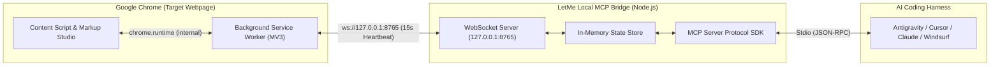

<p align="center">
  
</p>

<h1 align="center">LetMe</h1>

<p align="center">
  <b>High-precision visual UI/UX inspector, layout bug hunter, and multi-element debugging bridge for AI Coding Agents via Model Context Protocol (MCP).</b>
</p>

<p align="center">
  <a href="#license"></a>
  <a href="https://www.typescriptlang.org/"></a>
  <a href="https://developer.chrome.com/docs/extensions/mv3/"></a>
  <a href="https://modelcontextprotocol.io/"></a>
  <a href="https://nodejs.org/"></a>
</p>

<p align="center">
  <a href="README.md"><b>English</b></a> &bull; <a href="README.id.md">Bahasa Indonesia</a>
</p>

---

## Overview

Text prompts alone are notoriously ineffective for communicating visual and spatial frontend bugs to AI coding assistants. Describing complex CSS layout shifts, clipped ancestors, z-index collisions, and responsive edge-wrapping in chat often requires multiple round-trips of guesswork.

**LetMe** bridges this gap. It connects your live browser viewport directly to AI Coding Agents (**Google Antigravity**, **Cursor**, **Claude Desktop**, **Windsurf**, and **Cline**) using the open [Model Context Protocol (MCP)](https://modelcontextprotocol.io/).

With LetMe, you can inspect DOM elements, draw vector markup annotations, run multimodal AI vision audits, stage multiple components in one pass, and allow your AI assistant to inject **bidirectional live CSS previews** directly into your running browser tab before writing code.

---

## Key Capabilities

### 1. Precision Element Inspector
- **Full Box Model Telemetry**: Computes content, padding, border, and margin dimensions down to the exact sub-pixel.
- **Computed Styles Extraction**: Extracts key layout rules (`display`, `position`, `flex`, `grid`, `z-index`, `overflow`) without clutter.
- **Clean DOM & Selector Generation**: Generates deterministic CSS selectors (`div.card > span#title`) and trimmed outerHTML snippets.
- **Automated Layout Diagnostics**: Instantly flags ancestor clipping, z-index collisions, and horizontal viewport overflow leaks.

### 2. Canvas Markup Studio
- **Overlay Vector Annotations**: Draw arrows, bounding boxes, pixel measurement rulers, draggable text callouts, and censorship blur blocks directly over the page.
- **Non-Destructive Canvas**: Annotations render cleanly on an isolated viewport canvas without mutating webpage DOM or styling.

### 3. AI Vision Auto Bug Hunter
- **Multimodal Automated Audit**: Leverages any vision LLM (e.g., Google Gemini 2.0 Flash, Claude 3.5 Sonnet, GPT-4o via OpenRouter, Groq, or Ollama) to autonomously spot UI/UX defects, misalignment, and text truncation.
- **Contextual DOM Text Snapping**: Intelligently anchors detected visual anomalies directly to real underlying DOM nodes.
- **60 FPS Scroll Tracking**: High-performance `requestAnimationFrame` synchronization ensures bounding boxes and pin badges remain attached to elements during fast scrolling.
- **Interactive Slide-over Drawer**: Inspect bugs categorized by severity (`critical`, `warning`, `suggestion`), filter issues, and click to smooth-scroll directly to affected elements.

### 4. Multi-Element Stager
- **Batch Component Capture**: Click multiple UI elements across different sections or routes in a single session.
- **Per-Element Developer Notes**: Attach specific instructions or bug observations to each staged component.
- **Consolidated Dispatch**: Generates a unified, structured prompt with a unique session code (`[LETME MULTI-ELEMENT STAGE: LTM-...]`) ready for immediate pasting into chat.

### 5. Interactive Area Crop & Viewport Studio
- **Crosshair Selection**: Drag to capture any rectangular region or take full-viewport screenshots.
- **Instant Clipboard Integration**: Automatically formats and copies screenshots to your system clipboard while staging them in MCP.

### 6. Bidirectional Live CSS Preview
- **Zero-Reload Visual Testing**: Coding agents can invoke the `letme_apply_css_preview` MCP tool to apply CSS changes directly onto the active webpage.
- **Instant Reversion**: One-click reversion (`letme_clear_preview`) restores the original styling once approved or discarded.

### 7. Monochrome Minimalist Aesthetic
- **Zero AI Slop**: Built with an anti-bloat, high-contrast Linear/Vercel design system.
- **Official Lucide SVG Icons**: 100% inline vector icons for sharp rendering across high-DPI and Retina displays.

---

## Architecture



### Communication Flow:
1. **Chrome Extension (Client)**: Injected content script captures DOM snapshots, box models, and screenshot crops, transmitting them to the background service worker.
2. **WebSocket Bridge**: Service worker streams payloads to `ws://127.0.0.1:8765` with automated connection retry and a 15-second heartbeat keepalive.
3. **MCP Server**: Implements the Model Context Protocol over standard I/O (`stdio`), serving structured tools, markdown reports, and visual image blocks to the AI harness.
4. **Live Feedback**: AI-invoked style mutations travel back down the WebSocket to inject temporary preview stylesheets into the browser DOM in real time.

---

## Quick Start

### Installation & Execution

You can run LetMe's MCP Bridge directly via `npx` (fastest) or clone the repository to build the full monorepo and Chrome Extension from source.

#### Option A: Quick Launch via NPX (Zero Setup)
Configure your AI client (Cursor, Claude, Antigravity) to spawn the server directly via `npx`:

```json
{
  "mcpServers": {
    "letme": {
      "command": "npx",
      "args": ["-y", "@letme/mcp-server"]
    }
  }
}
```

Or install it globally to your system:
```bash
npm install -g @letme/mcp-server
letme-mcp
```

#### Option B: Clone & Build from Source (Full Extension + MCP Bridge)
```bash
git clone https://github.com/jinkaka98/LetMe.git
cd LetMe
npm install
npm run build
```

This compiles all packages (`@letme/shared`, `@letme/mcp-server`, and `@letme/extension`).

### Chrome Extension Installation

#### Method 1: Download Pre-built Release (Fastest)
1. Download **`letme-extension-v0.1.0.zip`** from [GitHub Releases](https://github.com/jinkaka98/LetMe/releases).
2. Extract the `.zip` archive to a folder on your computer.
3. Open Google Chrome and navigate to `chrome://extensions/`.
4. Enable **Developer mode** in the top-right corner.
5. Click **Load unpacked** and select the unzipped folder.
6. Pin the **LetMe** extension icon in your Chrome toolbar.

#### Method 2: Load from Local Build
If you cloned and built the repository:
1. Open Google Chrome and navigate to `chrome://extensions/`.
2. Enable **Developer mode**.
3. Click **Load unpacked** and select:
   ```
   <PATH_TO_LETME>/packages/extension/dist
   ```
*(You can also generate a portable zip anytime by running `npm run package:extension`)*.

---

## AI Agent Configuration

Configure LetMe in your preferred AI development environment by adding the server definition to the relevant configuration file.

### Google Antigravity IDE
Add to `~/.gemini/config/mcp_config.json`:
```json
{
  "mcpServers": {
    "letme": {
      "command": "node",
      "args": ["/ABSOLUTE/PATH/TO/LetMe/packages/mcp-server/dist/index.js"]
    }
  }
}
```

### Cursor
Add to `.cursor/mcp.json` (or via **Cursor Settings > Features > MCP Servers**):
```json
{
  "mcpServers": {
    "letme": {
      "command": "node",
      "args": ["/ABSOLUTE/PATH/TO/LetMe/packages/mcp-server/dist/index.js"]
    }
  }
}
```

### Claude Desktop
Add to `claude_desktop_config.json` (macOS: `~/Library/Application Support/Claude/claude_desktop_config.json`, Linux: `~/.config/Claude/claude_desktop_config.json`, Windows: `%APPDATA%\Claude\claude_desktop_config.json`):
```json
{
  "mcpServers": {
    "letme": {
      "command": "node",
      "args": ["/ABSOLUTE/PATH/TO/LetMe/packages/mcp-server/dist/index.js"]
    }
  }
}
```

### Windsurf & Cline
Add to your extension's MCP configuration settings:
```json
{
  "mcpServers": {
    "letme": {
      "command": "node",
      "args": ["/ABSOLUTE/PATH/TO/LetMe/packages/mcp-server/dist/index.js"]
    }
  }
}
```

---

## Workflows

### Workflow A: Single Element Inspection & Markup
1. Press `Alt + Shift + I` or click **Start Inspecting** in the LetMe popup.
2. Hover and click the target element on your webpage.
3. Use the toolbar to draw arrows, highlight boxes, add text callouts, or measure distances with the ruler tool.
4. Click **Send to AI** (or **Copy Prompt**).
5. Open your AI coding chat and press `Ctrl + V`. The prompt includes the element's DOM path, dimensions, and instructions.
6. The AI calls `letme_get_active_element` to retrieve the visual crop and computed styles.

### Workflow B: Autonomous AI Vision Bug Hunter
1. Open the LetMe popup -> Click **Settings** to set your AI provider and API Key (Google Gemini, OpenRouter, OpenAI, Groq, or local Ollama).
2. Click **Scan Page with AI Vision**.
3. LetMe captures the viewport, normalizes coordinates to DPR 1:1, and prompts the vision model.
4. Interactive severity badges (`#1`, `#2`, etc.) appear over the defective elements on the page.
5. Review issues in the floating slide-over drawer, or click **Send All to MCP**.
6. The prompt is automatically copied to your clipboard with a unique report code (`[LETME MCP REPORT: LTM-AI-...]`).
7. Paste into your AI chat to let your agent solve all issues simultaneously.

### Workflow C: Multi-Element Stager
1. Open the LetMe popup -> Click **Pick Elements & Staging**.
2. Click multiple components across the page (buttons, cards, navigation items).
3. Open the floating **Staging Pill** at the bottom-right corner to review the components.
4. Add per-component notes or instructions directly in the drawer.
5. Click **Sync to MCP** & paste into your AI chat.

### Workflow D: Live CSS Preview Loop
1. When your AI assistant proposes styling fixes, ask it to test them live:
   > *"Apply a CSS preview to verify the layout fix on `.hero-card`."*
2. The AI executes `letme_apply_css_preview(selector=".hero-card", cssRules={"padding": "24px", "display": "flex"})`.
3. The styles immediately reflect in your browser tab without reloading.
4. Inspect the change. If satisfied, ask the AI to commit the file changes to your codebase.

---

## MCP Tools Reference

LetMe registers the following tools with the MCP protocol:

| Tool Name | Parameters | Description | Return Content |
| :--- | :--- | :--- | :--- |
| `letme_get_active_element` | `id` *(string, optional)*: Specific report/element ID | Retrieves the active or specified inspected element, including box model, layout diagnostics, computed CSS, and annotated screenshot crop. | Markdown summary + Base64 PNG Image Block |
| `letme_list_inspections` | *(None)* | Lists all staged or historically captured elements stored in the current session. | Markdown table of components, selectors, and timestamps |
| `letme_apply_css_preview` | `selector` *(string, required)*: Target CSS selector<br>`cssRules` *(object, required)*: Key-value CSS rules | Injects live CSS style rules into the target element in the active browser tab. | Confirmation message with injected rule summary |
| `letme_clear_preview` | `selector` *(string, optional)*: Target selector to clear (clears all if omitted) | Removes injected preview CSS stylesheets and reverts the browser DOM to its original state. | Reversion confirmation message |
| `letme_get_console_logs` | `limit` *(number, optional, default: 20)*: Maximum entries to return | Fetches recent browser console error and warning logs captured from the active webpage. | Formatted list of console messages with log levels |

---

## Keyboard Shortcuts

| Shortcut | Context | Action |
| :--- | :--- | :--- |
| `Alt + Shift + I` | Any Webpage | Toggle Element Inspector on/off |
| `Esc` | Active Inspector | Cancel inspection or dismiss active modal/drawer |
| `Ctrl + Z` / `Cmd + Z` | Markup Studio | Undo last canvas annotation stroke |

---

## Monorepo Structure

```
LetMe/
├── packages/
│   ├── shared/             # Common TypeScript interfaces, metrics, and DTOs
│   │   ├── src/index.ts    # BoxModelMetrics, LayoutBugReport, ElementSnapshot
│   │   └── package.json
│   ├── mcp-server/         # Node.js MCP server & WebSocket bridge
│   │   ├── src/index.ts    # Server entry point & tool handlers
│   │   ├── src/state.ts    # In-memory session and inspection store
│   │   ├── test/           # Automated test suite (Node test runner)
│   │   └── package.json
│   └── extension/          # Chrome Extension (Manifest V3 + Vite)
│       ├── manifest.json   # Extension manifest & permissions
│       ├── src/
│       │   ├── icons.ts    # Lucide SVG icon definitions
│       │   ├── background/ # Service worker & WebSocket client
│       │   ├── content/    # Overlay UI, Markup Studio, Auto Bug Hunter
│       │   └── popup/      # Extension popup view & settings
│       └── package.json
├── package.json            # Root workspace configuration
└── tsconfig.json           # Base TypeScript configuration
```

---

## Development & Testing

### Running in Development Mode
Run development watchers in separate terminal tabs:

```bash
# Terminal 1: Watch & build extension
npm run dev:extension

# Terminal 2: Watch & build MCP server
npm run dev:server
```

### Running Test Suite
Execute the test suite powered by Node.js native test runner:

```bash
npm test
```

Tests cover:
- State store lifecycle and element snapshot persistence.
- Tool invocation handlers (`letme_get_active_element`, `letme_list_inspections`, `letme_apply_css_preview`, etc.).
- Markdown formatting and image block structure.
- CSS preview injection and timeout resolution.

---

## Troubleshooting & FAQ

#### 1. Why does the popup status say "MCP Offline"?
- Ensure the MCP Server is running or that your AI harness (Antigravity/Cursor) has launched it via MCP configuration.
- To run the server manually for standalone debugging:
  ```bash
  npm run start:server
  ```
- The extension automatically re-checks connection status and maintains a 15-second heartbeat keepalive.

#### 2. AI Vision returns HTTP 405 or "Method Not Allowed"
- Verify that your **Base URL** in LetMe Settings points to a valid OpenAI-compatible `/chat/completions` endpoint.
- For **Google Gemini**: Use `https://generativelanguage.googleapis.com/v1beta/openai/` with model `gemini-2.0-flash`.
- For **OpenRouter**: Use `https://openrouter.ai/api/v1` with model `google/gemini-2.0-flash-001`.
- For **Ollama**: Ensure Ollama is running locally with vision support (e.g., `http://127.0.0.1:11434/v1`).

#### 3. Do I need to reload the extension after code changes?
- Content scripts and background service workers update when you click the **Reload (🔄)** button in `chrome://extensions/`. After reloading, refresh your target webpage tab.

---

## Contributing

Contributions are warmly welcomed! Please read our guidelines before submitting a pull request:

1. **Fork** the repository and create a feature branch (`git checkout -b feat/my-feature`).
2. Adhere to the established **monochrome minimalist** aesthetic (no raw unicode emojis in UI code, use `packages/extension/src/icons.ts`).
3. Ensure all tests pass: `npm test`.
4. Ensure clean builds across workspaces: `npm run build`.
5. Submit a pull request with a clear description of changes.

---

## License & Author

This project is licensed under the [MIT License](https://github.com/jinkaka98/LetMe/blob/main/LICENSE). Open-source software designed for developers and AI agents alike.

Authored and maintained with precision by **G assad S Eks Xixero1445** ([@jinkaka98](https://github.com/jinkaka98)). Contributions, issues, and discussions are welcome!
